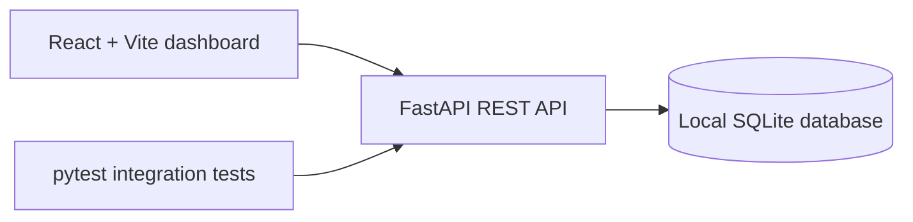

# UptimePilot — Digital Solution9 Engineering Portfolio

## v0.5: Engineering upgrade

**New features:** Per-monitor reliability reports, host allowlisting and stricter URL validation.

**Security:** owner-only session authentication, password hashing, session revocation and an operator-provided first-account token (`OWNER_SETUP_TOKEN`) now protect the API. Create a unique 24+ character token in your local environment before initial registration. No real user/client data should be entered.

**Run locally:** In `backend/`, install `requirements.txt`, set `OWNER_SETUP_TOKEN` to a random secret (for example, generate one with `python -c "import secrets; print(secrets.token_urlsafe(32))"`), then run `uvicorn main:app --reload`. In `frontend/`, run `npm install` and `npm run dev`. Register the first owner with the same setup token in the login screen. Afterward, additional registration is disabled. Run tests using `cd backend && python -m pytest -q`.

**Scope:** This is a local portfolio MVP, not a deployment-ready, multi-user, audited production service. `COOKIE_SECURE=1` and HTTPS are required for any reviewed internet deployment. Previous notes below describe earlier releases and may not reflect the current authentication behavior.

---

# UptimePilot

> HTTP uptime and latency monitoring

**Status:** Working local portfolio MVP, not a production-ready SaaS. The UI and API persist data in a local SQLite database.


## What's new in v0.3

**Focus:** per-monitor uptime reports.

- Per-monitor uptime percentage and average latency
- Bounded per-monitor check history
- Offline deterministic test using synthetic check data

The **Advanced tools** panel on the dashboard exercises the new API endpoints. The backend smoke tests now include a regression test for this functionality.

## Architecture



The app is a **local demo MVP**, not an enterprise production service. The API uses no authentication or tenant isolation. Run only with synthetic data.

## GitHub repository description

> HTTP uptime monitor with per-monitor reliability and latency reporting.

## Main v0.3 APIs

- Standard: `GET /api/health`, `GET /api/items`, `POST /api/items`, `GET /api/summary`
- `GET /api/monitors/{monitor_id}/metrics`
- `GET /api/monitors/{monitor_id}/history`

## Portfolio story

**Engineering focus:** Health checks, HTTP resilience, time series.  
**Implemented features:** monitor configuration, manual checks, uptime history.

## Stack

- **Frontend:** React 19, Vite, vanilla CSS, responsive dashboard
- **Backend:** Python 3.11+, FastAPI, SQLite, OpenAPI / Swagger
- **Testing:** pytest, FastAPI TestClient (basic API smoke tests)

## Run locally

Use **two terminals**:

```bash
cd backend
python -m venv .venv
source .venv/bin/activate  # Windows: .venv\Scripts\activate
pip install -r requirements.txt
uvicorn main:app --reload --port 8000
```

```bash
cd frontend
npm install
npm run dev
```

Open **http://localhost:5173** and view API documentation at **http://localhost:8000/docs**.

## Sample data

```bash
cd backend
python seed_demo.py
```

Inserts synthetic records into an empty local database. The uptime monitor starts empty by design because checks require network access.

## Tests

```bash
cd backend
python -m pytest -q
```

## Suggested portfolio extensions

- Add a real authentication provider and server-side authorisation
- Move to PostgreSQL with managed migrations
- Extend integration and browser test coverage
- Add GitHub Actions, container deployment, monitoring and observability
- Conduct accessibility and security review before any public production deployment

## Security / limitations

This MVP does **not** implement authentication, authorisation, rate limits, audit logs, or production hardening. Use **synthetic demonstration data only**, especially for medical and client-oriented projects. The monitoring application must not be hosted publicly without further network-isolation/SSRF protections. Payments, real medical data, and LLM integrations are intentionally **not** implemented. Do not claim otherwise on your CV.

## License

MIT. See LICENSE.

---

## Portfolio showcase & quality checks

[](https://github.com/shakaleita/UptimePilot-API-Monitoring/actions/workflows/portfolio-checks.yml)

**Engineering focus:** HTTP health checks, uptime history, and latency metrics.

Part of my [10-project full-stack engineering portfolio](https://github.com/shakaleita/teamforge-saas/blob/main/PORTFOLIO.md). Browse the full collection for related domain projects and engineering trade-offs.

**Project status:** Local portfolio MVP. CI exercises backend tests and the frontend build; an automated check does not imply production security or a deployed demo. The newer v0.4 security release is not part of this v0.3 GitHub source until explicitly integrated and reviewed.
